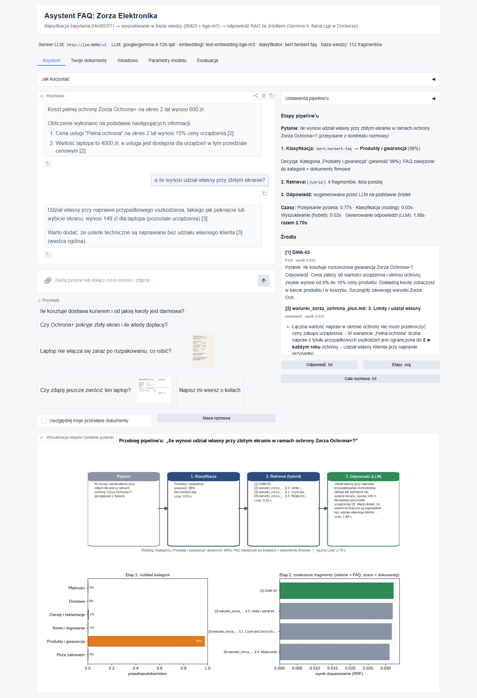
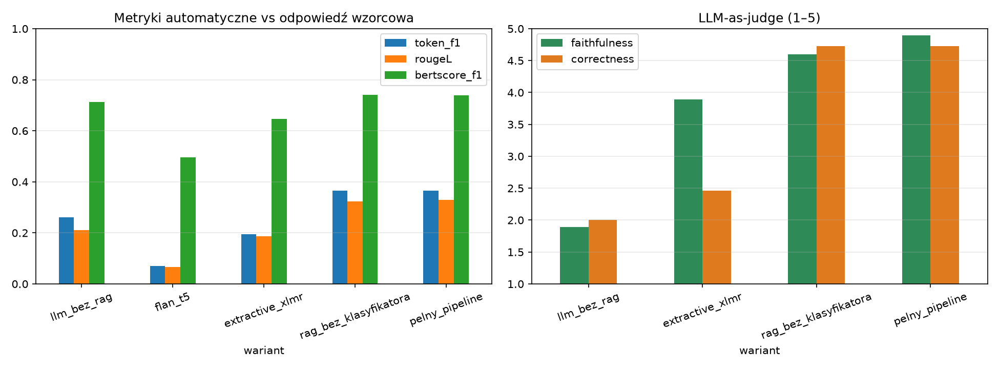

# Asystent FAQ: klasyfikacja → retrieval → RAG

Projekt zaliczeniowy z przedmiotu dotyczącego dużych modeli językowych.
**Temat 29: „Kompletny pipeline: klasyfikacja → QA → RAG dla firmowej bazy FAQ”.**
Autor: Piotr Smoła, nr albumu 125162. Sprawozdanie: [Sprawozdanie_Projekt_LLM.docx](Sprawozdanie_Projekt_LLM.docx).

Asystent obsługi klienta **fikcyjnego** sklepu internetowego *Zorza Elektronika*. Dla każdego pytania:

1. **klasyfikuje** je dostrojonym modelem BERT (HerBERT) do jednej z 6 kategorii i na tej podstawie wybiera
   dalszą ścieżkę (routing),
2. **wyszukuje** pasujące wpisy FAQ i fragmenty dokumentów firmowych (BM25 + embeddingi bge-m3 w ChromaDB),
3. **generuje odpowiedź** lokalnym modelem Gemma 4 12B (llama.cpp) wyłącznie na podstawie znalezionych
   źródeł i wskazuje je w tekście numerami `[n]`.

Pytania można zadawać tekstem albo obrazem (zrzut e-maila, zdjęcie paragonu lub faktury). Długie wiadomości
z kilkoma sprawami naraz są dzielone na podpytania, z osobnym routingiem i wyszukiwaniem dla każdego.
Wszystkie modele działają **lokalnie na GPU**, bez usług w chmurze, a cały projekt w **kontenerach Dockera**.

**Szybki start** (Windows z Docker Desktop i kartą NVIDIA): w katalogu projektu uruchom `start.bat`.
Skrypt sprawdza GPU, pobiera modele (albo bierze je z LM Studio, jeśli są na komputerze), uruchamia kontenery
i otwiera aplikację pod `http://localhost:7860`. Szczegóły w [punkcie 3](#3-konfiguracja-środowiska-krok-po-kroku).



---

## Spis treści
1. [Realizacja wymagań na poszczególne oceny](#1-realizacja-wymagań-na-poszczególne-oceny)
2. [Architektura](#2-architektura)
3. [Konfiguracja środowiska krok po kroku](#3-konfiguracja-środowiska-krok-po-kroku)
4. [Uruchomienie i przykłady użycia](#4-uruchomienie-i-przykłady-użycia)
5. [Wyniki ewaluacji](#5-wyniki-ewaluacji)
6. [Struktura repozytorium](#6-struktura-repozytorium)
7. [Ograniczenia i wnioski](#7-ograniczenia-i-wnioski)

---

## 1. Realizacja wymagań na poszczególne oceny

| Próg | Wymaganie (Projekt.pdf) | Gdzie zrealizowane |
|---|---|---|
| **3.0** | gotowe narzędzie do podstawowej funkcjonalności, kroki konfiguracji, znaczenie parametrów, przykłady | **llama.cpp** (`llama-server`) z modelami GGUF w kontenerach Dockera, start jednym poleceniem (`start.bat`); [docs/01_konfiguracja_docker_llama_cpp.md](docs/01_konfiguracja_docker_llama_cpp.md) (kontenery, wymagania, modele, flagi serwera, zasoby, parametry generowania, typowe problemy); notebook [01_parametry_llm.ipynb](notebooks/01_parametry_llm.ipynb) (eksperymenty z temperature, top_p, top_k, seed, max_tokens, repeat_penalty, reasoning_effort i budżetem rozumowania); zakładka *Parametry modelu* w aplikacji |
| **3.5** | funkcjonalność wielomodalna | pytania jako **obraz** (Gemma 4 + projektor `mmproj`): odczyt tekstu (OCR), sformułowanie pytania i wykorzystanie danych z dokumentu w odpowiedzi – `src/faq_assistant/vision.py`; przykłady w `data/examples/*.png` |
| **4.0** | aplikacja w Pythonie realizująca automatyzację | `scripts/batch.py` i zakładka *Wsadowo*: hurtowe przetwarzanie pytań z CSV/TXT/XLSX → CSV, XLSX, JSONL, raport TXT, SVG; `scripts/generate_training_data.py`: **automatyczne generowanie 720 przykładów treningowych przez LLM** |
| **4.5** | konwersacja przez API modelu, inżynieria promptów, pytania do przesłanych plików, pliki wynikowe *.txt i *.svg | czat wieloturowy przez API serwera llama.cpp (zgodne z OpenAI, streaming); prompty w [prompts.py](src/faq_assistant/prompts.py) (rola, reguły, few-shot, wymuszony JSON, cytowania, przepisywanie pytań uzupełniających); zakładka *Twoje dokumenty* (upload .txt/.md/.pdf → indeks sesji → pytania); eksport odpowiedzi i rozmowy do **.txt** i wizualizacji etapów do **.svg** |
| **5.0** | odpowiedzi na podstawie wiedzy modelu i danych z dokumentów (RAG) | pełny pipeline RAG: FAQ i 4 dokumenty firmowe (oraz pliki użytkownika) → wyszukiwanie hybrydowe → odpowiedź z cytowaniem `[n]`; fakty o sklepie wyłącznie ze źródeł, wiedza ogólna modelu oznaczana dopiskiem „(wiedza ogólna)” |

### Wymagania tematu 29

| Punkt tematu | Realizacja |
|---|---|
| Etap 1: fine-tuning BERT do kierowania zapytania | `allegro/herbert-base-cased` dostrojony na 794 pytaniach (6 klas); porównanie z DistilBERT multilingual, TF-IDF+LR i LLM zero-shot; kategoria zawęża wyszukiwanie, „poza zakresem” → odmowa bez wywołania LLM |
| Etap 2: korpus FAQ, indeksowanie, wyszukiwanie | 74 wpisy FAQ + 4 dokumenty (38 fragmentów); TF-IDF, BM25, dense (bge-m3 + ChromaDB), hybryda RRF; Recall@k, MRR |
| Etap 3: extractive BERT lub generatywny FLAN-T5 | generatywnie: Gemma 4 (tryb główny); do porównania: extractive XLM-R SQuAD2 oraz FLAN-T5-base z Lab 3 |
| Spięcie w pipeline z pokazaniem źródła | `pipeline.py` – obiekt `PipelineTrace` z wynikami i czasami etapów; cytowania `[n]` i lista źródeł |
| Demo i wizualizacja etapów | aplikacja Gradio: panel *Etapy pipeline'u*, lista źródeł, wykres etapów (także eksport SVG) |
| Synergia komponentów | **ablacja** w `scripts/evaluate.py` (sam LLM / RAG bez klasyfikatora / pełny pipeline) – [wyniki](#5-wyniki-ewaluacji) |

Powiązanie z laboratoriami: Lab 2 (fine-tuning BERT, baseline TF-IDF+LR, learning curve), Lab 3 (extractive QA,
FLAN-T5, EM/Token-F1, RAG TF-IDF vs BM25, top-k źródeł z wynikami), Lab 4 (ROUGE, BERTScore),
Lab 5 (halucynacje, faithfulness).

---

## 2. Architektura

```
                 ┌──────────────── obraz (opcjonalnie) ─────────────────┐
                 │  Gemma 4 + mmproj: OCR + sformułowanie pytania       │
                 └──────────────────────────┬───────────────────────────┘
 pytanie ──► [przepisanie z historii] ──────┤ (gdy jest kontekst rozmowy, LLM)
             [pytanie złożone → podpytania] ┤ (kilka spraw naraz: etapy 1-2 osobno dla każdego podpytania)
                                            ▼
        ETAP 1  Klasyfikacja – HerBERT (fine-tuning), 6 klas, ~10 ms
                 ├─ „poza zakresem” (pewność ≥ 0.55) ──► odmowa, bez LLM
                 ├─ kategoria (pewność ≥ 0.55) ───────► filtr: FAQ tej kategorii + dokumenty
                 └─ niska pewność ─────────────────────► cała baza wiedzy
                                            ▼
        ETAP 2  Retrieval – BM25 (stemming PL) + dense (bge-m3, ChromaDB) → RRF → top-4
                 (+ pliki przesłane przez użytkownika w tej sesji)
                                            ▼
        ETAP 3  Odpowiedź – Gemma 4 12B (llama.cpp): prompt z rolą i regułami, numerowane źródła,
                 cytowania [n], dane z obrazu klienta, data bieżąca → streaming do czatu
                                            ▼
        PipelineTrace ──► UI (etapy, źródła, wykres) · eksport .txt / .svg · batch CSV/XLSX
```

| Warstwa | Technologia |
|---|---|
| Serwer modeli | llama.cpp b12808 (`llama-server`, obraz `ghcr.io/ggml-org/llama.cpp:server-cuda`), dwa kontenery na GPU: LLM `:8080`, embeddingi `:8081`; API zgodne z OpenAI |
| Konteneryzacja | Docker Compose: `llm`, `embeddings`, `app` (python:3.14-slim, PyTorch CPU); start: `start.bat` / `start.sh` |
| LLM | `google/gemma-4-12b-qat` (Gemma 4 12B Instruct, QAT Q4_0, 6,7 GB) + `mmproj` (obraz) |
| Embeddingi | `text-embedding-bge-m3` (BGE-M3 Q8_0, wektory 1024-wym., wielojęzyczny) |
| Klasyfikator | `allegro/herbert-base-cased` + HF Transformers `Trainer` (trening na GPU w bf16 albo na CPU w kontenerze) |
| Baza wektorowa | ChromaDB 1.5 (persistent, metryka cosinusowa, filtr metadanych) |
| Wyszukiwanie leksykalne | rank-bm25 (Okapi BM25), scikit-learn (TF-IDF) |
| Aplikacja | Gradio 6.32; CLI: argparse |
| Ewaluacja | scikit-learn, rouge-score, własny BERTScore (mBERT), LLM-as-judge |
| Środowisko testowe | Windows 11, Docker Desktop (WSL2), RTX 5070 Ti 16 GB; poza Dockerem Python 3.14.3, PyTorch 2.15 + CUDA 13.2 |

Szczegóły modułów: [docs/02_architektura.md](docs/02_architektura.md).

---

## 3. Konfiguracja środowiska krok po kroku

Pełna instrukcja z wyjaśnieniem flag serwera i parametrów generowania:
**[docs/01_konfiguracja_docker_llama_cpp.md](docs/01_konfiguracja_docker_llama_cpp.md)**.

### 3.1. Wymagania
* Windows 10/11 z **Docker Desktop** (backend WSL2) albo Linux z Docker Engine i NVIDIA Container Toolkit,
* karta **NVIDIA** z co najmniej 12 GB VRAM i sterownikiem 570 lub nowszym (projekt zajmuje około 10,4 GB VRAM),
* około 20 GB wolnego miejsca (modele 7,8 GB, obrazy Dockera 10,5 GB) i internet przy pierwszym uruchomieniu.

Pythona, CUDA ani LM Studio nie trzeba instalować.

### 3.2. Uruchomienie
```bat
start.bat
```

Na Linuksie: `./start.sh`. Skrypt kolejno: uruchamia Docker Desktop, jeśli nie działa; sprawdza, czy kontenery
widzą kartę NVIDIA; szuka modeli GGUF (w `models/gguf/` albo w katalogu LM Studio) i w razie braku pobiera je
z Hugging Face (7,8 GB); buduje obraz aplikacji, uruchamia trzy kontenery, czeka na załadowanie modeli i otwiera
`http://localhost:7860`. Pierwsze uruchomienie trwa kilkanaście minut (pobieranie), kolejne około 1,5 minuty.

| Polecenie | Działanie |
|---|---|
| `start.bat` | start całego projektu |
| `start.bat stop` | zatrzymanie kontenerów (modele, indeks i wyniki zostają na dysku) |
| `start.bat status` / `start.bat logs` | stan kontenerów / logi na żywo |
| `start.bat test` | testy jednostkowe w kontenerze |
| `start.bat train` | fine-tuning HerBERT w kontenerze (na CPU około 5 minut) |

| Kontener | Zawartość | Adres na komputerze |
|---|---|---|
| `app` | aplikacja Gradio, pipeline, HerBERT, ChromaDB, skrypty i notebooki | `http://localhost:7860` |
| `llm` | llama.cpp: Gemma 4 12B QAT + `mmproj` (obraz), GPU | `http://localhost:8080/v1` |
| `embeddings` | llama.cpp: bge-m3, GPU | `http://localhost:8081/v1` |

Ustawienia (porty, katalog modeli `GGUF_DIR`) są w pliku `.env`, który skrypt tworzy z `.env.example`.

### 3.3. Pierwsze uruchomienie: co dzieje się automatycznie
* **Modele GGUF** trafiają do `models/gguf/`. Jeśli są już w LM Studio (`%USERPROFILE%\.lmstudio\models`),
  skrypt używa tej kopii i zapisuje ścieżkę w `.env` jako `GGUF_DIR`.
* **Indeks bazy wiedzy** (wolumen `chroma`) buduje się sam przy pierwszym starcie aplikacji (ok. 8 s).
* **Klasyfikator HerBERT** (`models/herbert-faq`, 479 MB) jest w archiwum do oddania, ale nie w repozytorium git.
  Jeśli go brak, aplikacja sama trenuje zastępczy klasyfikator TF-IDF (< 1 s). Pełny HerBERT odtwarza
  `start.bat train` (dane treningowe są w repozytorium).

### 3.4. Uruchamianie poza Dockerem (opcjonalnie)
Do pracy nad kodem aplikację i skrypty można uruchamiać w lokalnym środowisku Pythona (≥ 3.11, testowane na
3.14), a modele zostawić w kontenerach (`docker compose up -d llm embeddings`) albo w LM Studio:

```bash
python -m venv .venv
.venv\Scripts\activate                     # Linux/macOS: source .venv/bin/activate
pip install torch --index-url https://download.pytorch.org/whl/cu132   # PyTorch z CUDA, np. do treningu na GPU
pip install -r requirements.txt
pip install -e .                           # pakiet faq_assistant (src/)
copy .env.example .env                     # adresy serwerów: porty 8080 i 8081 (LM Studio: 1234)
python -m faq_assistant.llm data/examples/mail_reklamacja.png   # test: czat, embeddingi, obraz
python app.py
```

---

## 4. Uruchomienie i przykłady użycia

### 4.1. Aplikacja
Po `start.bat` aplikacja działa pod `http://localhost:7860`.

| Zakładka | Funkcja |
|---|---|
| **Asystent** | czat tekst + obraz, panel etapów pipeline'u, lista źródeł, wykres etapów, eksport .txt/.svg; ustawienia: metoda wyszukiwania, top-k, wybór klasyfikatora, parametry generowania |
| **Twoje dokumenty** | upload .txt/.md/.pdf → indeks sesji → pytania do plików (także w czacie po zaznaczeniu opcji) |
| **Wsadowo** | hurtowe przetwarzanie pliku z pytaniami → CSV, XLSX, raport TXT, opcjonalnie SVG |
| **Parametry modelu** | eksperymenty z temperature/top_p/top_k/repeat_penalty/max_tokens/seed/reasoning + opis parametrów |
| **Ewaluacja** | tabele i wykresy z katalogu `results/` |

**Przykład 1 – pytanie wymagające obliczenia na podstawie dokumentu**
> **Pytanie:** Ile kosztuje pełna ochrona Zorza Ochrona+ na 2 lata dla laptopa za 4000 zł?
> **Routing:** Produkty i gwarancja (99%) → FAQ tej kategorii + dokumenty
> **Odpowiedź:** Koszt pełnej ochrony na 2 lata wynosi 15% ceny urządzenia [2]. Dla laptopa o wartości 4000 zł kwota ta wyniesie 600 zł. […]
> **Źródła:** warunki_zorza_ochrona_plus.md (sekcje „Zakup”, „Czym jest Zorza Ochrona+”, „Limity”), GWA-02

**Przykład 2 – dopytanie z kontekstu rozmowy**
> **Pytanie:** a ile wynosi udział własny przy zbitym ekranie?
> **Przepisane:** Ile wynosi udział własny przy zbitym ekranie w ramach ochrony Zorza Ochrona+?
> **Odpowiedź:** Udział własny przy naprawie przypadkowego uszkodzenia (takiego jak pęknięcie ekranu) dla laptopa wynosi 149 zł [3]. […]

**Przykład 3 – obraz: faktura + pytanie** (`data/examples/faktura_laptop.png`)
> **Pytanie z obrazu:** Czy zdążę jeszcze zwrócić laptop Voltbook 14 zakupiony w sklepie internetowym w dniu 05.11.2026?
> **Odpowiedź:** Tak […] towar kupiony przez internet można zwrócić w ciągu 30 dni od jego doręczenia [2]. Ponieważ zamówienie zostało dostarczone 07.11.2026, termin na odstąpienie od umowy upływa 07.12.2026. […]

**Przykład 4: pytanie złożone (5 spraw w jednej wiadomości)**
> Wiadomość z pytaniami o raty i punkty, fakturę z NIP, dostawę z wniesieniem w sobotę, reklamację laptopa, blokadę
> konta i Zorza Ochrona+ zostaje podzielona na 12 podpytań. Każde przechodzi klasyfikację i wyszukiwanie, a do
> kontekstu trafia 24 fragmentów. Odpowiedź ma 5 ponumerowanych punktów i tabelę podsumowania, m.in. termin zwrotu
> 07.12.2026, korekta NIP do 30.11, Pełna ochrona za 774 zł (18% z 4300 zł).

**Przykład 5 – pytanie poza zakresem**
> **Pytanie:** Napisz mi przepis na sernik → klasyfikator: *poza zakresem* (100%) → odmowa bez wywołania LLM (0,4 s).

**Przykładowe wyniki do pobrania** (wygenerowane przez aplikację, eksport .txt i .svg):

| Przykład | Wejście | Wynik |
|---|---|---|
| pytanie z obliczeniem (przykład 1) | tekst | [przyklad_tekst.txt](results/examples/przyklad_tekst.txt), [przyklad_tekst.svg](results/examples/przyklad_tekst.svg) |
| rozmowa z dopytaniem (przykład 2) | tekst + historia | [przyklad_rozmowa.txt](results/examples/przyklad_rozmowa.txt), [przyklad_dopytanie.svg](results/examples/przyklad_dopytanie.svg) |
| faktura na obrazie (przykład 3) | [faktura_laptop.png](data/examples/faktura_laptop.png) | [przyklad_obraz.txt](results/examples/przyklad_obraz.txt), [przyklad_obraz.svg](results/examples/przyklad_obraz.svg) |
| pytanie złożone (przykład 4) | [pytanie_zlozone.txt](data/examples/pytanie_zlozone.txt) | [przyklad_zlozone.txt](results/examples/przyklad_zlozone.txt), [przyklad_zlozone.svg](results/examples/przyklad_zlozone.svg) |
| poza zakresem (przykład 5) | tekst | [przyklad_poza_zakresem.txt](results/examples/przyklad_poza_zakresem.txt) |
| pytanie do przesłanego pliku (zakładka *Twoje dokumenty*) | [regulamin_promocji_black_friday.txt](data/examples/regulamin_promocji_black_friday.txt) + pytanie „Do kiedy trwa promocja i czy rabat 15% łączy się z kodem z newslettera?” | odpowiedź: promocja 27-30.11.2026, rabat nie łączy się z kodami z newslettera [1], [2]; raport .txt z przyciskiem pobierania |
| tryb wsadowy, 10 pytań | [pytania.csv](data/examples/pytania.csv) | [wyniki.xlsx](results/batch/wyniki.xlsx), [wyniki.csv](results/batch/wyniki.csv), [raport.txt](results/batch/raport.txt), [svg/](results/batch/svg/) |

Zrzuty ekranu aplikacji: [docs/screenshots/](docs/screenshots/).

### 4.2. Skrypty (CLI)

W Dockerze polecenia uruchamia się w kontenerze aplikacji: `docker compose exec app <polecenie>`, np.
`docker compose exec app python scripts/batch.py data/examples/pytania.csv --out results/batch --svg`.
Wyniki zapisują się w katalogach `results/`, `models/` i `notebooks/` na dysku. Poza Dockerem te same polecenia
działają w środowisku z punktu 3.4.

| Polecenie | Opis |
|---|---|
| `python scripts/batch.py data/examples/pytania.csv --out results/batch --svg` | przetwarzanie wsadowe (próg 4.0) |
| `python scripts/generate_training_data.py --per-category 120` | generowanie danych treningowych przez LLM |
| `python scripts/train_classifier.py train` | fine-tuning HerBERT (`--model distilbert/distilbert-base-multilingual-cased --out models/distilbert-faq` – wariant porównawczy) |
| `python scripts/train_classifier.py compare --bert models/herbert-faq models/distilbert-faq` | porównanie klasyfikatorów na ręcznym zbiorze testowym |
| `python scripts/train_classifier.py curve --sizes 50 100 200 400 800` | learning curve |
| `python scripts/build_index.py` | przebudowa indeksu + porównanie metod wyszukiwania dla przykładowego pytania |
| `python scripts/evaluate.py` | ewaluacja retrievalu, QA i ablacji (`--part retrieval|qa|bertscore`) |
| `python scripts/build_notebooks.py` | zbudowanie i wykonanie notebooków (w Dockerze: `docker compose run --rm --build --no-deps app python scripts/build_notebooks.py`) |
| `python scripts/download_models.py --check` | sprawdzenie plików GGUF (bez `--check`: pobranie z Hugging Face) |
| `python scripts/screenshots.py` | zrzuty ekranu działającej aplikacji (Playwright, uruchamiane na komputerze) |
| `pytest` | 21 testów jednostkowych, bez serwerów modeli (atrapa LLM); w Dockerze `start.bat test` |

---

## 5. Wyniki ewaluacji

### 5.1. Etap 1 – klasyfikacja (ręczny zbiór testowy, 90 pytań, 6 klas)

| Model | Accuracy | F1-macro | Czas / zapytanie |
|---|---|---|---|
| TF-IDF (słowa) + LR – baseline z Lab 2 | 0,722 | 0,717 | < 0,1 ms |
| TF-IDF (n-gramy znakowe 2–5) + LR | 0,844 | 0,845 | < 0,1 ms |
| DistilBERT multilingual (fine-tuning) | 0,778 | 0,767 | 2 ms |
| **HerBERT (fine-tuning) – router w pipeline** | **0,889** | **0,892** | **10 ms** |
| Gemma 4 zero-shot (few-shot prompt) | 1,000 | 1,000 | 288 ms |

Learning curve (F1-macro, średnia z 3 seedów): przy ~50–200 przykładach TF-IDF jest lepszy od HerBERT
(0,56 vs 0,23 przy 48 przykładach), HerBERT wyprzedza go od ~400 przykładów (0,85 vs 0,79) i osiąga 0,88 na pełnym zbiorze.
Szczegóły i analiza błędów: [notebooks/02_klasyfikator.ipynb](notebooks/02_klasyfikator.ipynb).

### 5.2. Etap 2 – wyszukiwanie (37 pytań o sklep; trafienie = źródło wzorcowe w wynikach)

| Metoda | Routing | Recall@1 | Recall@3 | Recall@4 | MRR |
|---|---|---|---|---|---|
| TF-IDF | cała baza | 0,595 | 0,811 | 0,811 | 0,713 |
| TF-IDF | filtr kategorii | 0,622 | 0,838 | 0,919 | 0,745 |
| BM25 | cała baza | 0,622 | 0,865 | 0,919 | 0,758 |
| BM25 | filtr kategorii | 0,703 | 0,919 | 0,973 | 0,811 |
| dense (bge-m3) | cała baza | 0,811 | 0,919 | 0,973 | 0,878 |
| dense (bge-m3) | filtr kategorii | **0,892** | 0,946 | 0,973 | **0,921** |
| hybryda RRF | cała baza | 0,730 | **1,000** | **1,000** | 0,847 |
| hybryda RRF | filtr kategorii | 0,811 | 0,973 | 0,973 | 0,878 |

Routing klasyfikatorem poprawia MRR każdej metody (+0,03 do +0,05).

### 5.3. Etap 3 – jakość odpowiedzi i ablacja (40 pytań; LLM-as-judge 1–5)

| Wariant | Token-F1 | ROUGE-L | BERTScore-F1 | Faithfulness | Correctness | Odmowa poza zakresem |
|---|---|---|---|---|---|---|
| sam LLM, bez RAG | 0,262 | 0,210 | 0,712 | 1,89 | 2,00 | 0 / 3 |
| FLAN-T5-base (Lab 3) na tych samych źródłach | 0,071 | 0,067 | 0,495 | – | – | 0 / 3 |
| extractive XLM-R SQuAD2 na tych samych źródłach | 0,194 | 0,187 | 0,647 | 3,89 | 2,46 | 0 / 3 |
| RAG bez klasyfikatora | 0,365 | 0,324 | 0,741 | 4,60 | 4,73 | 3 / 3 |
| **pełny pipeline** | **0,366** | **0,330** | 0,739 | **4,89** | **4,73** | **3 / 3** |



Wnioski z ablacji (szerzej w [notebooks/03_ewaluacja_pipeline.ipynb](notebooks/03_ewaluacja_pipeline.ipynb)):
* **RAG jest kluczowy** – bez dokumentów model zmyśla zasady sklepu (faithfulness 1,9, correctness 2,0).
* **Klasyfikator poprawia ugruntowanie** (faithfulness 4,60 → 4,89), skraca kontekst i odcina pytania spoza
  zakresu bez wywołania LLM.
* **BERTScore słabo odróżnia halucynację od poprawnej odpowiedzi** (0,712 vs 0,739) – płynny, tematycznie
  podobny tekst dostaje wysoki wynik; dlatego potrzebna jest ocena ugruntowania (LLM-as-judge).
* Modele z laboratoriów (FLAN-T5, extractive QA) radzą sobie słabo z polskimi pytaniami i odpowiedziami
  wymagającymi łączenia faktów lub obliczeń.

---

## 6. Struktura repozytorium

```
app.py                       aplikacja Gradio
start.bat, start.ps1, start.sh  uruchomienie całego projektu w Dockerze jednym poleceniem
docker-compose.yml           kontenery: llm i embeddings (llama.cpp, GPU), app, models (pobieranie GGUF)
Dockerfile, docker/          obraz aplikacji, przypięte wersje bibliotek (constraints.txt)
src/faq_assistant/
  config.py                  konfiguracja (.env), kategorie, parametry generowania
  llm.py                     klient serwerów modeli (API OpenAI): czat, streaming, obraz, embeddingi
  prompts.py                 szablony promptów (inżynieria promptów)
  classifier.py              BERT / TF-IDF / LLM – wspólny interfejs
  ingest.py                  FAQ i dokumenty → fragmenty
  retrieval.py               TF-IDF, BM25, dense (ChromaDB), hybryda RRF, filtr kategorii
  qa.py                      odpowiedź RAG, extractive QA, FLAN-T5
  vision.py                  obraz → pytanie
  pipeline.py                orkiestracja etapów, PipelineTrace
  export.py                  eksport .txt i .svg
scripts/                     batch, generowanie danych, trening, indeks, ewaluacja, notebooki, zrzuty, pobieranie modeli
data/faq/faq.jsonl           74 wpisy FAQ (5 kategorii)
data/docs/                   regulamin, polityka zwrotów, cennik dostaw, warunki Zorza Ochrona+
data/classifier/             train.jsonl (794, w tym 720 z LLM), test.jsonl (90, ręczny)
data/eval/qa_eval.jsonl      40 pytań ewaluacyjnych ze źródłami i odpowiedziami wzorcowymi
data/examples/               obrazy przykładowe, pytania do trybu wsadowego
notebooks/                   01 parametry LLM (llama.cpp) · 02 klasyfikator · 03 ewaluacja
results/                     metryki, wykresy, przykładowe raporty
docs/                        konfiguracja Dockera i llama.cpp, architektura, zrzuty ekranu
tests/                       testy jednostkowe
```

---

## 7. Ograniczenia i wnioski

* **Dane fikcyjne** – firma, dokumenty i FAQ są wymyślone na potrzeby projektu; dane treningowe klasyfikatora
  zostały wygenerowane przez LLM, test jest ręczny i rozłączny.
* **LLM-as-judge** – oceny wystawia ten sam model (Gemma), który generuje odpowiedzi, więc mogą być zawyżone;
  wnioski porównawcze między wariantami pozostają wiarygodne, wartości bezwzględne należy traktować ostrożnie.
* **Mały zbiór ewaluacyjny** (40 pytań) – różnice rzędu 0,01–0,03 nie są istotne statystycznie.
* **Kalibracja klasyfikatora** – HerBERT myli się z wysoką pewnością (8 z 10 błędów ma pewność > 0,85),
  dlatego próg pewności słabo odfiltrowuje błędy; LLM zero-shot klasyfikuje lepiej, ale jest ~30× wolniejszy.
* **Model rozumujący** – Gemma 4 domyślnie „myśli” przed odpowiedzią; bez `reasoning_effort="none"` krótkie
  limity `max_tokens` dawały puste odpowiedzi.

### Archiwum do oddania
Archiwum `Piotr_Smoła_125162_Projekt_LLM.zip` zawiera repozytorium razem z wytrenowanym klasyfikatorem
`models/herbert-faq` (479 MB) i klasyfikatorem zastępczym `models/tfidf_lr.joblib`. Nie zawiera plików modeli GGUF
(`start.bat` pobiera je przy pierwszym uruchomieniu), środowiska `.venv/` ani indeksu bazy wiedzy (budowany
automatycznie przy pierwszym uruchomieniu).
